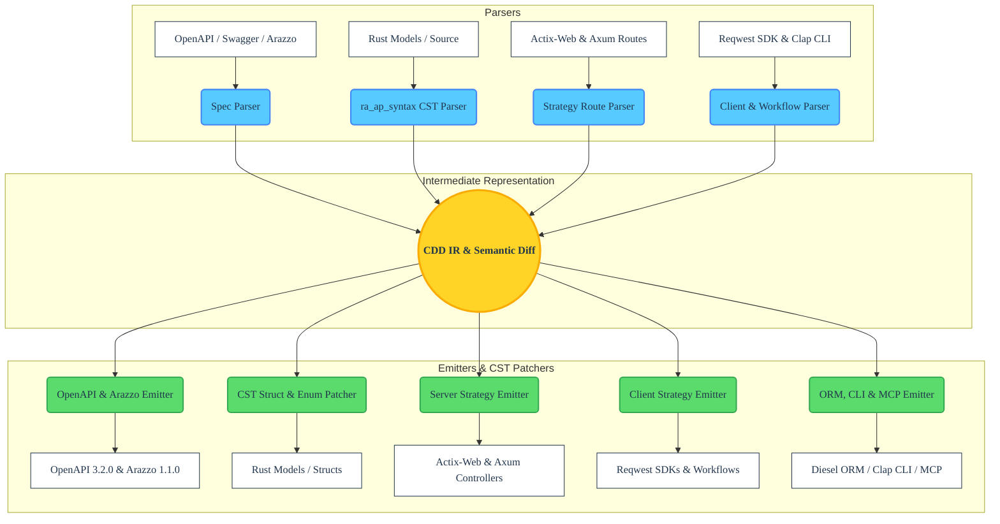

# cdd-rust Architecture

<!-- BADGES_START -->

<!-- BADGES_END -->

The **cdd-rust** tool acts as a dedicated lossless compiler and transpiler. Its fundamental architecture follows standard compiler design principles, divided into three distinct phases: **Frontend (Parsing)**, **Intermediate Representation (IR)**, and **Backend (Emitting & Surgical Patching)**.

This decoupled design ensures that any format capable of being parsed into the IR can subsequently be emitted or patched into any supported output format—whether that is an Actix-Web or Axum server route, a Reqwest client SDK, a Clap CLI, a Diesel ORM model, an Arazzo 1.1.0 workflow orchestrator, an MCP adapter, or an OpenAPI 3.2.0 specification.

## 🏗 High-Level Overview

## 🧩 Core Components

### 1. The Frontend (Parsers)

The Frontend's responsibility is to read an input source and translate it into the universal CDD Intermediate Representation (IR).

* **Static Analysis (CST-Driven via `ra_ap_syntax`)**: For `Rust` source code, the tool **does not** use dynamic reflection or execute the code. Instead, it parses source files into a lossless Concrete Syntax Tree (CST) using `ra_ap_syntax` (`rust-analyzer`'s syntax tree engine for Rust Edition 2021), preserving whitespace, comments, docstrings, and attributes while extracting structs, enums, functions, type signatures, Reqwest client calls, Actix-Web/Axum server routes, and Arazzo workflow steps.
* **OpenAPI, Swagger & Arazzo Parsing**: For OpenAPI 3.2.0, Swagger 2.0, JSON Schema (2020-12), and Arazzo 1.1.0 inputs, the parser normalizes legacy specifications, resolves internal and external `$ref`s (`DocumentRegistry`), and extracts models, routes, security schemes, webhooks, callbacks, and multi-step workflow graphs into the IR.

### 2. Intermediate Representation (IR) & Semantic Diffing

The Intermediate Representation (`cdd-core`) is the normalized, language-agnostic data structure representing:
* **Models (`ParsedStruct` / `ParsedEnum` / `JsonSchema`)**: Entities containing typed fields, serde/utoipa attributes, required constraints, defaults, and rustdoc descriptions.
* **Endpoints / Operations (`ParsedRoute`)**: HTTP verbs, paths, path/query/header/cookie parameters, request bodies, security requirements, links, callbacks, webhooks, and responses.
* **Workflows (`ArazzoDocument` / `Workflow` / `Step`)**: Multi-step operation DAGs, runtime expressions, criteria, and success/failure actions.
* **Structural Diffs (`StructDiff` / `FieldChange`)**: Computed differences between existing CST nodes and target specifications to drive lossless in-place patching.

### 3. The Backend (Emitters & Surgical Patchers)

The Backend takes the universal IR (and optional CST diffs) and emits or patches target outputs via the `BackendStrategy`, `CliStrategy`, and `WorkflowStrategy` traits:

* **Lossless CST Patcher (`cdd_core::classes::patcher`)**: Modifies existing `.rs` files in-place without disturbing user comments, formatting, or custom handler bodies.
* **Server Emitters (`ActixStrategy`, `AxumStrategy`, `McpServerStrategy`)**: Create and update Actix-Web and Axum route handlers, router configurations, MCP server handlers, and contract tests.
* **Client & CLI Emitters (`ReqwestStrategy`, `ClapCliStrategy`, `McpClientStrategy`)**: Create async Reqwest API clients, Arazzo workflow orchestrators, Clap v4 CLI binaries, and MCP client adapters.
* **Database ORM Sync (`DieselMapper`)**: Bridges Diesel `schema.rs` (`dsync`), Rust structs, and OpenAPI schemas.
* **Specification Emitters**: Serialize the IR into compliant OpenAPI 3.2.0, JSON Schema 2020-12, and Arazzo 1.1.0 JSON or YAML documents.

## 🔄 Extensibility

Because of the strategy and IR design, adding support for a new `Rust` framework requires minimal effort:
1. **To support parsing a new framework**: Implement extraction into `ParsedRoute` / `ParsedStruct` in `cdd-core`.
2. **To support emitting a new framework**: Implement the `BackendStrategy` / `WorkflowStrategy` traits in `cdd_core::strategies`.

## 🛡 Design Principles

1. **A Single Source of Truth**: Maintain definitions in whichever format is most ergonomic (OpenAPI/Arazzo files, Rust structs/handlers, or Diesel `schema.rs`) and synchronize the rest.
2. **Zero-Execution Parsing**: Strictly statically analyze inputs without compiling or executing untrusted target code.
3. **Lossless Conversion**: Retain formatting, comments, docstrings, type annotations, and attributes across `Source ⇄ CST/IR ⇄ Target`.
4. **Symmetric Operations**: Every operation and workflow in the IR holds all metadata required to emit both server handlers and client SDK/CLI orchestrators.
