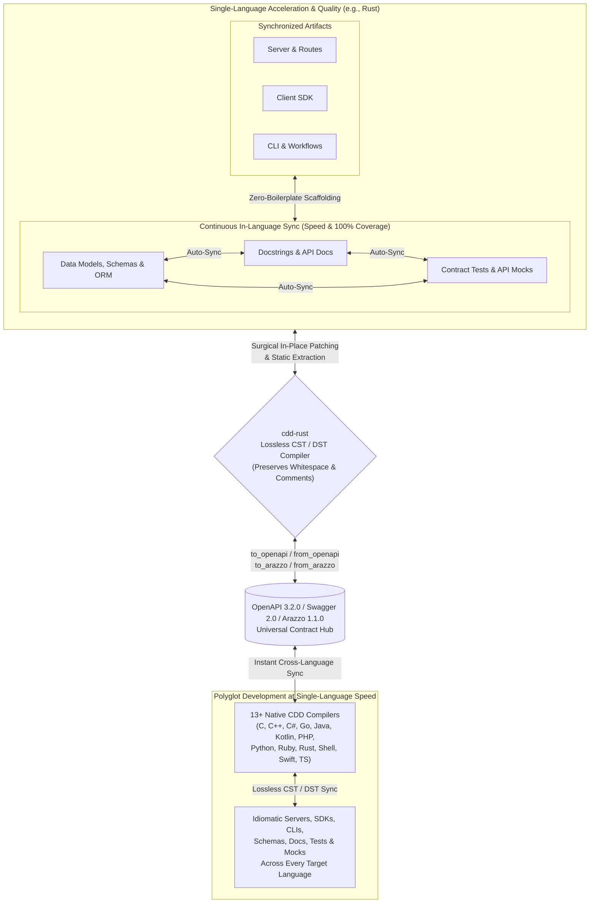

cdd-rust: Rust ⇄ OpenAPI
========================

[](https://opensource.org/licenses/Apache-2.0)
[](https://offscale.io/wasm_web_demo)
[](https://github.com/SamuelMarks/cdd-rust/actions)
[](#)
[](#)

**cdd-rust** compiles **[OpenAPI](https://spec.openapis.org/oas/latest.html) / [Swagger](https://spec.openapis.org/oas/v2.0.html) / [Arazzo](https://spec.openapis.org/arazzo/latest.html)** to and from **Rust** (servers, client SDKs, CLIs, database schemas, tests, mocks, and docs), updating your existing code in-place without overwriting your edits.

**Compiler Driven Development (CDD)** is a software engineering methodology that uses a suite of standalone, lossless compilers to synchronize API specifications, server implementations, client SDKs, command-line tooling, workflow orchestrators, tests, and documentation.

Unlike traditional code generators that treat outputs as disposable or read-only, Compiler Driven Development provides a **complete, standalone compiler** (exposed as both a CLI and a programmatic SDK) written natively in each supported language. Where conventional compilers rely solely on an Abstract Syntax Tree (AST) that discards formatting and comments, CDD compilers operate on a **Concrete Syntax Tree (CST)** or **Decorated Syntax Tree (DST)**. This guarantees **lossless conversion**—preserving exact whitespace, indentation, inline comments, block comments, and docstrings—allowing true bidirectional synchronization between hand-edited `Rust` source code and [OpenAPI 3.2.0](https://spec.openapis.org/oas/v3.2.0.html), [Swagger 2.0](https://spec.openapis.org/oas/v2.0.html), and [Arazzo 1.1.0](https://spec.openapis.org/arazzo/v1.1.0.html) specifications.

---

## Why Compiler Driven Development?

By replacing one-way templates and manual boilerplate with lossless CST/DST compilers, Compiler Driven Development transforms the engineering lifecycle across four dimensions:

- **Development Speed**: Eliminate manual boilerplate across servers, client SDKs, CLIs, database models, workflow runners, and mock servers. Start from an [OpenAPI](https://spec.openapis.org/oas/latest.html) or [Arazzo](https://spec.openapis.org/arazzo/latest.html) specification to scaffold an entire installable project (complete with package manifests and CI workflows), or write code first in `Rust` and extract the specification automatically. When requirements change, update whichever representation is most convenient and synchronize the rest immediately.
- **Development Consistency**: Every data model, route handler, CLI flag, ORM entity, workflow step, and API contract is derived from and validated against the same semantic representation. Architectural drift between backend routes, frontend clients, and published specifications becomes structurally impossible.
- **Development Quality**: Keeping tests and documentation in lockstep with implementation code is automated rather than an afterthought. Because the compiler parses and emits docstrings, type signatures, API mocks, and contract test suites alongside your business logic, maintaining **100% documentation coverage and 100% test coverage** becomes a natural byproduct of compilation rather than a manual chore.
- **Polyglot Development**: Seamlessly bridge **13+ programming languages** (C, C++, C#, Go, Java, Kotlin, PHP, Python, Ruby, Rust, POSIX Shell, Swift, and TypeScript) to and from [OpenAPI](https://spec.openapis.org/oas/latest.html) and [Arazzo](https://spec.openapis.org/arazzo/latest.html) specifications. Any codebase in any supported language can be reverse-compiled into OpenAPI/Arazzo and immediately compiled forward into idiomatic, human-editable code across every other language in the suite. And being an open-source methodology—rather than a proprietary trade secret—new languages can be added by implementing new compilers that follow the CDD approach (see [cdd-spec-conformance](https://github.com/SamuelMarks/cdd-spec-conformance) for tooling to facilitate).

---

## The Standalone Compiler Architecture and Lossless Conversion

Traditional code generation tools rely on destructive templating: if you regenerate your project from an updated specification, your custom implementation logic, formatting, and comments are overwritten.

Each Compiler Driven Development toolchain is written natively in its target language, compiles both to native binaries and to **WebAssembly (WASM/WASI)**, and implements a full lexer, parser, semantic differ, and code emitter backed by Concrete Syntax Tree (CST) and Decorated Syntax Tree (DST) representations:

- **Beyond AST to CST/DST**: A standard Abstract Syntax Tree (AST) captures program semantics while stripping away "trivia" (whitespace, blank lines, and comments). By pairing structural AST semantics with a Concrete Syntax Tree (CST) or Decorated Syntax Tree (DST) that attaches trivia and structured documentation directly to syntax nodes, the compiler preserves 100% of your source formatting and comments.
- **Zero-Destruction Guarantee**: Every part of the generated codebase is designed to be edited by humans. You can open generated routing files, data models, database entities, workflow runners, tests, and CLI commands, format them to your preferences, add inline comments, and inject custom business logic.
- **When your specification changes**: The CDD compiler parses your existing source files into a CST/DST, computes a semantic diff against the updated [OpenAPI](https://spec.openapis.org/oas/latest.html) or [Arazzo](https://spec.openapis.org/arazzo/latest.html) specification, and surgically patches in new endpoints, workflows, parameters, or fields without disturbing your custom logic, comments, or whitespace.
- **When your codebase changes**: The compiler statically analyzes your updated source code, routes, workflows, tests, and docstrings—without unsafe dynamic code execution or reflection—to extract a 100% compliant, authoritative [OpenAPI](https://spec.openapis.org/oas/latest.html) or [Arazzo](https://spec.openapis.org/arazzo/latest.html) specification.

---

## The Bidirectional Synchronization Loop



The Compiler Driven Development lifecycle delivers compounding returns in both single-language and polyglot environments:
1. **Single-Language Speed**: Edit whichever artifact is most convenient—models/schemas, route handlers, docstrings, or tests—and let `cdd-rust` surgically synchronize the rest in-place without overwriting your custom logic, comments, or whitespace.
2. **Single-Language Quality**: Because schemas, documentation, contract tests, and mocks are continuously cross-compiled rather than manually maintained, **100% doc coverage and 100% test coverage** are enforced automatically on every sync.
3. **Polyglot Development at Single-Language Speed**: Extracting an authoritative [OpenAPI](https://spec.openapis.org/oas/latest.html) or [Arazzo](https://spec.openapis.org/arazzo/latest.html) contract from one language immediately drives lossless forward-compilation across all 13+ supported languages—making multi-language SDK, CLI, and service maintenance just as fast as working in a single codebase.

---

## Core Capabilities Shared Across All CDD Compilers

Every `cdd-*` repository in the suite implements the same foundational feature set:

- **Bidirectional OpenAPI 3.2.0 & Swagger 2.0 Compilation**:
  - `from_openapi`: Generate idiomatic `Rust` Client SDKs (`to_sdk`), Client CLIs (`to_sdk_cli`), and Server stubs/routers (`to_server`) from a single specification (`-i`) or a batch directory of specifications (`--input-dir`). Automatically upgrades legacy Swagger 2.0 and OpenAPI 3.0/3.1 specifications to OpenAPI 3.2.0.
  - `to_openapi`: Statically parse existing `Rust` source files or directories to extract a compliant OpenAPI 3.2.0 specification.
- **Bidirectional Arazzo 1.1.0 Workflow Orchestration**:
  - `from_arazzo`: Compile multi-step [Arazzo 1.1.0](https://spec.openapis.org/arazzo/v1.1.0.html) workflow specifications (including runtime expressions, step DAGs, criterion evaluations, and failure/success actions) into `Rust` SDK workflow orchestrators (`to_sdk`), CLI workflow runners (`to_sdk_cli`), and Server/E2E workflow test suites (`to_server`).
  - `to_arazzo`: Reverse-parse `Rust` workflow orchestrators, CLI scripts, or E2E test suites back into an authoritative Arazzo 1.1.0 document.
- **In-Place Codebase Synchronization (`sync`)**:
  - Synchronize data models, ORM schemas, route handlers, docstrings, contract tests, mocks, and specifications in-place using lossless CST/DST patching.
- **Documentation Code-Snippet Generation (`to_docs_json`)**:
  - Emit a structured JSON documentation payload containing idiomatic `Rust` request/workflow code snippets for every operation in an OpenAPI specification (with `--no-imports` and `--no-wrapping` options for embedding in documentation portals).
- **Composable Contract Tests, Mocks, CI, and Package Scaffolding**:
  - By default, `from_openapi` and `from_arazzo` scaffold complete, installable `Rust` packages and `.github/workflows/ci.yml` pipelines (configurable via `--no-installable-package` and `--no-github-actions`), and generate contract test suites and API mocks/fakes via `--tests`.
- **Model Context Protocol (`mcp`) & JSON-RPC (`serve_json_rpc`)**:
  - Run `cdd-rust mcp` to expose the compiler over stdio as an [MCP](https://modelcontextprotocol.io/) server for AI assistants and IDEs, or pass `--mcp` during generation to emit MCP tool/resource adapters directly inside generated SDKs and servers.
  - Run `cdd-rust serve_json_rpc` to expose the compiler's full API over JSON-RPC 2.0 (`--port`, `--listen`).
- **Native CLI, Programmatic SDK, and WebAssembly (WASM/WASI)**:
  - Use `cdd-rust` from the command line, import its programmatic SDK directly into `Rust` applications, or run it in the browser and WASI runtimes via its WebAssembly build (see [WASM.md](WASM.md)).

---

## The Global Polyglot Ecosystem

Every supported language operates on the same core Compiler Driven Development principles and is powered by a dedicated, native compiler tailored to that language's syntax tree, idioms, and package manager.

All implementations expose a standardized command-line interface (`cdd-rust <subcommand>`) and programmatic SDK.

| Repository | Language | Targets (`to_sdk`; `to_sdk_cli`; `to_server`) | Special Features Beyond Common Subset | Standards | CI Status |
|---|---|---|---|---|---|
| [`cdd-c`](https://github.com/SamuelMarks/cdd-c) | C (C89) | Client; Client CLI; Server | 42-Language FFI Generator (`bind`); GNU-to-C89 AST Lowering; Safe CRT & Memory Security Auditor; `c-orm` Migrations | [Arazzo 1.1.0](https://spec.openapis.org/arazzo/v1.1.0.html); [Swagger 2.0](https://spec.openapis.org/oas/v2.0.html); [OpenAPI 3.2.0](https://spec.openapis.org/oas/v3.2.0.html); [MCP](https://modelcontextprotocol.io/) | [](https://github.com/SamuelMarks/cdd-c/actions/workflows/ci.yml) |
| [`cdd-cpp`](https://github.com/SamuelMarks/cdd-cpp) | C++ | Client; Client CLI; Server | [Google Discovery](https://developers.google.com/discovery) (`from_google_discovery`); PostgreSQL `libpq` ORM & Faker Support | [Google Discovery](https://developers.google.com/discovery); [Arazzo 1.1.0](https://spec.openapis.org/arazzo/v1.1.0.html); [Swagger 2.0](https://spec.openapis.org/oas/v2.0.html); [OpenAPI 3.2.0](https://spec.openapis.org/oas/v3.2.0.html); [MCP](https://modelcontextprotocol.io/) | [](https://github.com/SamuelMarks/cdd-cpp/actions/workflows/ci.yml) |
| [`cdd-csharp`](https://github.com/SamuelMarks/cdd-csharp) | C# | Client; Client CLI; Server | CLR & Roslyn CST/DST Trivia-Preserving Sync; Entity Framework & Minimal API Targets | [Arazzo 1.1.0](https://spec.openapis.org/arazzo/v1.1.0.html); [Swagger 2.0](https://spec.openapis.org/oas/v2.0.html); [OpenAPI 3.2.0](https://spec.openapis.org/oas/v3.2.0.html); [MCP](https://modelcontextprotocol.io/) | [](https://github.com/SamuelMarks/cdd-csharp/actions/workflows/ci.yml) |
| [`cdd-go`](https://github.com/SamuelMarks/cdd-go) | Go | Client; Client CLI; Server | Go `dst`/`ast` Surgical Patching; Multi-Source Truth Sync (`code` ⇄ `openapi`) | [Arazzo 1.1.0](https://spec.openapis.org/arazzo/v1.1.0.html); [Swagger 2.0](https://spec.openapis.org/oas/v2.0.html); [OpenAPI 3.2.0](https://spec.openapis.org/oas/v3.2.0.html); [MCP](https://modelcontextprotocol.io/) | [](https://github.com/SamuelMarks/cdd-go/actions/workflows/ci.yml) |
| [`cdd-java`](https://github.com/SamuelMarks/cdd-java) | Java | Client; Client CLI; Server | JavaParser CST Lexical Preservation; WASI JSON-RPC Mode; In-Memory Compiler Pipeline | [Arazzo 1.1.0](https://spec.openapis.org/arazzo/v1.1.0.html); [Swagger 2.0](https://spec.openapis.org/oas/v2.0.html); [OpenAPI 3.2.0](https://spec.openapis.org/oas/v3.2.0.html); [MCP](https://modelcontextprotocol.io/) | [](https://github.com/SamuelMarks/cdd-java/actions/workflows/ci.yml) |
| [`cdd-kotlin`](https://github.com/offscale/cdd-kotlin) | Kotlin (Ktor Multiplatform) | Client; Client CLI; Server | Multiplatform Auto-Admin UI; Ephemeral & Seeded Mock Server Modes; Webhook Triggers | [Arazzo 1.1.0](https://spec.openapis.org/arazzo/v1.1.0.html); [Swagger 2.0](https://spec.openapis.org/oas/v2.0.html); [OpenAPI 3.2.0](https://spec.openapis.org/oas/v3.2.0.html); [MCP](https://modelcontextprotocol.io/) | [](https://github.com/offscale/cdd-kotlin/actions/workflows/ci.yml) |
| [`cdd-php`](https://github.com/SamuelMarks/cdd-php) | PHP | Client; Client CLI; Server | Multi-Tiered DAO (`StubDao` / `ConcreteDao`); Ephemeral & Faker-Seeded SQLite Server Modes | [Arazzo 1.1.0](https://spec.openapis.org/arazzo/v1.1.0.html); [Swagger 2.0](https://spec.openapis.org/oas/v2.0.html); [OpenAPI 3.2.0](https://spec.openapis.org/oas/v3.2.0.html); [MCP](https://modelcontextprotocol.io/) | [](https://github.com/SamuelMarks/cdd-php/actions/workflows/ci.yml) |
| [`cdd-python`](https://github.com/offscale/cdd-python) | Python | N/A (server building blocks) | CLI ⇄ SQLAlchemy ⇄ Pydantic ⇄ Docs ⇄ JSON Schema | N/A | [](https://github.com/offscale/cdd-python/actions) |
| [`cdd-python-all`](https://github.com/offscale/cdd-python-all) | Python | Client; Client CLI; Server | `LibCST` Lossless Sync; Multi-Truth Sync (`class`, `sqlalchemy`, `function`, `openapi`); FastAPI + SQLAlchemy | [Arazzo 1.1.0](https://spec.openapis.org/arazzo/v1.1.0.html); [Swagger 2.0](https://spec.openapis.org/oas/v2.0.html); [OpenAPI 3.2.0](https://spec.openapis.org/oas/v3.2.0.html); [MCP](https://modelcontextprotocol.io/) | [](https://github.com/offscale/cdd-python-all/actions/workflows/ci.yml) |
| [`cdd-ruby`](https://github.com/SamuelMarks/cdd-ruby) | Ruby | Client; Client CLI; Server | ActiveRecord Sync (`class`, `activerecord`, `function`); Ephemeral & Seeded Server Generation | [Arazzo 1.1.0](https://spec.openapis.org/arazzo/v1.1.0.html); [Swagger 2.0](https://spec.openapis.org/oas/v2.0.html); [OpenAPI 3.2.0](https://spec.openapis.org/oas/v3.2.0.html); [MCP](https://modelcontextprotocol.io/) | [](https://github.com/SamuelMarks/cdd-ruby/actions/workflows/ci.yml) |
| [`cdd-rust`](https://github.com/SamuelMarks/cdd-rust) | Rust | Client; Client CLI; Server | Actix-Web, Axum & Reqwest Targets; Diesel Schema Sync; Standalone `schema-gen`, `scaffold` & `test-gen` | [Arazzo 1.1.0](https://spec.openapis.org/arazzo/v1.1.0.html); [Swagger 2.0](https://spec.openapis.org/oas/v2.0.html); [OpenAPI 3.2.0](https://spec.openapis.org/oas/v3.2.0.html); [MCP](https://modelcontextprotocol.io/) | [](https://github.com/SamuelMarks/cdd-rust/actions/workflows/ci.yml) |
| [`cdd-sh`](https://github.com/SamuelMarks/cdd-sh) | Shell (`/bin/sh`) | Client; Client CLI; Server | Zero-Dependency Embedded `sh`/`jq`/`awk` Cross-Platform Binary; Direct AST `parse` & `emit` Subcommands | [Arazzo 1.1.0](https://spec.openapis.org/arazzo/v1.1.0.html); [Swagger 2.0](https://spec.openapis.org/oas/v2.0.html); [OpenAPI 3.2.0](https://spec.openapis.org/oas/v3.2.0.html); [MCP](https://modelcontextprotocol.io/) | [](https://github.com/SamuelMarks/cdd-sh/actions/workflows/ci.yml) |
| [`cdd-swift`](https://github.com/SamuelMarks/cdd-swift) | Swift | Client; Client CLI; Server | `SwiftSyntax` Lossless Merging (`merge_swift`); Vapor + Fluent ORM Scaffolding; `sync_arazzo` | [Arazzo 1.1.0](https://spec.openapis.org/arazzo/v1.1.0.html); [Swagger 2.0](https://spec.openapis.org/oas/v2.0.html); [OpenAPI 3.2.0](https://spec.openapis.org/oas/v3.2.0.html); [MCP](https://modelcontextprotocol.io/) | [](https://github.com/SamuelMarks/cdd-swift/actions/workflows/ci.yml) |
| [`cdd-ts`](https://github.com/offscale/cdd-ts) | TypeScript | Client; Client CLI; Server | Auto-Admin UI; Angular, React, Vue, Vanilla; Fetch, Axios, Node; Express, Bun, Deno; TypeORM Sync | [Arazzo 1.1.0](https://spec.openapis.org/arazzo/v1.1.0.html); [Swagger 2.0](https://spec.openapis.org/oas/v2.0.html); [OpenAPI 3.2.0](https://spec.openapis.org/oas/v3.2.0.html); [MCP](https://modelcontextprotocol.io/) | [](https://github.com/offscale/cdd-ts/actions/workflows/ci.yml) |

---

## Programmatic SDK & CLI Quickstart

Every `cdd-*` toolchain can be invoked either as a standalone CLI binary or imported as a native `Rust` library.

### Minimal CLI Usage

```sh
# Print help and version
cdd-rust --help
cdd-rust --version

# Generate a Rust Client SDK, Client CLI, or Server from an OpenAPI spec
cdd-rust from_openapi to_sdk -i spec.json -o ./sdk --tests
cdd-rust from_openapi to_sdk_cli -i spec.json -o ./cli --tests
cdd-rust from_openapi to_server -i spec.json -o ./server --tests

# Extract an OpenAPI 3.2.0 spec from existing Rust source code
cdd-rust to_openapi -i ./src -o openapi.json

# Generate and extract Arazzo 1.1.0 multi-step workflows
cdd-rust from_arazzo to_sdk -i workflow.arazzo.json -o ./workflows --tests
cdd-rust from_arazzo to_sdk_cli -i workflow.arazzo.json -o ./workflow-cli --tests
cdd-rust from_arazzo to_server -i workflow.arazzo.json -o ./workflow-server --tests
cdd-rust to_arazzo -i ./workflows -o extracted.arazzo.json

# Synchronize codebase models, routes, tests, docs, and OpenAPI in-place
cdd-rust sync -i ./src -o openapi.json

# Generate documentation-ready Rust code snippets JSON for an OpenAPI spec
cdd-rust to_docs_json --no-imports --no-wrapping -i spec.json -o docs.json

# Run as a Model Context Protocol (MCP) server over stdio or JSON-RPC 2.0 server
cdd-rust mcp
cdd-rust serve_json_rpc --port 8080 --listen 127.0.0.1
```

### Programmatic SDK Example

```rust
use std::path::PathBuf;
use cdd_cli::{
    from_arazzo, from_openapi, sync, to_openapi, FromArazzoConfig, FromArazzoSubcommand,
    FromOpenApiConfig, FromOpenApiSubcommand, ServerFramework, SyncConfig, TargetMode,
    ToOpenApiConfig,
};
use cdd_core::error::AppResult;
use cdd_core::openapi::parse::parse_openapi_document;

fn main() -> AppResult<()> {
    // 1. Parse an OpenAPI 3.2.0 / Swagger 2.0 specification directly via cdd_core
    let raw_spec = std::fs::read_to_string("spec.json")?;
    let parsed_doc = parse_openapi_document(&raw_spec)?;
    println!("Parsed {} routes", parsed_doc.routes.len());

    // 2. Generate an Actix-Web or Axum server scaffold with contract tests & MCP adapters
    from_openapi(&FromOpenApiConfig {
        subcommand: FromOpenApiSubcommand::ToServer,
        input: Some(PathBuf::from("spec.json")),
        output_dir: Some(PathBuf::from("./server")),
        framework: ServerFramework::ActixWeb,
        tests: true,
        mcp: true,
        ..Default::default()
    })?;

    // 3. Extract an authoritative OpenAPI 3.2.0 specification from existing Rust source code
    to_openapi(&ToOpenApiConfig {
        input: PathBuf::from("./server/src"),
        output: PathBuf::from("openapi.json"),
        target: TargetMode::ServerActix,
        ..Default::default()
    })?;

    // 4. Generate an Arazzo 1.1.0 Reqwest Client SDK workflow orchestrator
    from_arazzo(&FromArazzoConfig {
        subcommand: FromArazzoSubcommand::ToSdk,
        input: Some(PathBuf::from("workflow.arazzo.json")),
        output_dir: Some(PathBuf::from("./workflows")),
        tests: true,
        ..Default::default()
    })?;

    // 5. Synchronize project models and OpenAPI specifications in-place
    sync(&SyncConfig {
        dir: PathBuf::from("./server"),
    })?;

    Ok(())
}
```

### Installation & Development

All `cdd-*` repositories support both native language build tools and a standardized cross-platform `Makefile` / `make.bat` interface (`deps`, `build`, `test`):

```sh
make deps
make build
make test
# or on Windows:
.\make.bat deps
.\make.bat build
.\make.bat test
```

Using native Rust `cargo` tooling directly:

```sh
# Fetch dependencies and build workspace release binaries
cargo fetch
cargo build --workspace --release

# Install the cdd-rust CLI binary locally
cargo install --path cli

# Run unit and integration tests across cdd-core, cdd-cli, and cdd-web
cargo test --workspace

# Enforce formatting, Clippy lints, and rustdoc verification
cargo fmt --all -- --check
cargo clippy --workspace --all-targets -- -D warnings
cargo doc --no-deps --workspace
```

> **Further Documentation**:
> - [**ARCHITECTURE.md**](ARCHITECTURE.md) — Compiler pipeline (Lexer → CST/DST/AST → Semantic Diff → Emitter).
> - [**COMPLIANCE.md**](COMPLIANCE.md) — Swagger 2.0, OpenAPI 3.2.0, Arazzo 1.1.0, and MCP support matrices.
> - [**USAGE.md**](USAGE.md) — Detailed CLI, SDK, ORM, and roundtrip usage guide.
> - [**DEVELOPING.md**](DEVELOPING.md) — Local development, linting, testing, and coverage guide.
> - [**WASM.md**](WASM.md) — WebAssembly / WASI build and browser/Node.js execution instructions.
> - [**PUBLISH.md**](PUBLISH.md) — Package publishing and release workflow.

---

## Universal CLI Toolchain

Once you learn the Compiler Driven Development CLI in one language, you can use the exact same commands, flags, and environment variables across the entire polyglot stack.

### Common Arguments & Environment Variables

| Flag | Short | Environment Variable | Description |
|---|---|---|---|
| `--help` | `-h` | — | Print help information for the CLI or subcommand. |
| `--version` | `-v` / `-V` | — | Print version information. |
| `--input <path>` | `-i` / `-f` | `CDD_INPUT` | Path or URL to the input OpenAPI/Arazzo spec or source file/directory. |
| `--input-dir <dir>` | `-d` | `CDD_INPUT_DIR` | Directory containing multiple OpenAPI/Arazzo specifications for batch generation. |
| `--output <path>` | `-o` | `CDD_OUTPUT` | Destination file or directory path for generated code or extracted specifications. |
| `--tests` | `-t` | `CDD_TESTS` | Generate composable contract/integration tests and API mocks alongside code. |
| `--mcp` | `-m` | `CDD_MCP` | Generate Model Context Protocol (MCP) server and client adapters. |
| `--no-github-actions` | — | `CDD_NO_GITHUB_ACTIONS` | Do not generate `.github/workflows/ci.yml` scaffolding in target output. |
| `--no-installable-package` | — | `CDD_NO_INSTALLABLE_PACKAGE` | Do not generate package manifest/build files in target output. |
| `--no-imports` | — | `CDD_NO_IMPORTS` | (`to_docs_json`) Omit import/include statements from generated documentation snippets. |
| `--no-wrapping` | — | `CDD_NO_WRAPPING` | (`to_docs_json`) Omit boilerplate wrapper functions/classes from documentation snippets. |
| `--port <port>` | `-p` | `CDD_PORT` | (`serve_json_rpc`) TCP port to listen on (default: `8080`). |
| `--listen <addr>` | `-l` | `CDD_LISTEN` | (`serve_json_rpc`) Host/IP address to bind to (default: `127.0.0.1`). |
| `--truth <source>` | `-t` | `CDD_TRUTH` | (`sync`) Designate the single source of truth when synchronizing. |

### Core Subcommands

- **`from_openapi [to_sdk | to_sdk_cli | to_server]`**: Compile an OpenAPI 3.2.0 or Swagger 2.0 specification into an idiomatic `Rust` Client SDK, Client CLI, or HTTP Server (patching existing files losslessly if the target directory already exists).
- **`to_openapi`**: Statically parse `Rust` models, routes, client calls, and docstrings into an authoritative OpenAPI 3.2.0 specification.
- **`from_arazzo [to_sdk | to_sdk_cli | to_server]`**: Compile an Arazzo 1.1.0 workflow specification into `Rust` workflow orchestrators, CLI workflow runners, or server/E2E workflow test suites.
- **`to_arazzo`**: Statically parse `Rust` workflow code, CLI scripts, or E2E tests into an Arazzo 1.1.0 specification.
- **`sync`**: Bidirectionally synchronize `Rust` source files (models, ORM entities, routes, functions, tests, and docstrings) with OpenAPI/Arazzo specifications in-place.
- **`to_docs_json`**: Generate documentation-optimized JSON containing `Rust` code snippets for each operation in an OpenAPI specification.
- **`serve_json_rpc`**: Expose the `cdd-rust` compiler over a JSON-RPC 2.0 server for IDE integrations and external tooling.
- **`mcp`**: Run the `cdd-rust` compiler as a Model Context Protocol (MCP) server over standard I/O (`stdio`).

### Verbatim CLI Help Output

#### `cdd-rust --help`

```console
CDD Toolchain CLI

Standard Commands:
  from_openapi    Generate code from an OpenAPI specification.
  to_openapi      Generate an OpenAPI specification from source code.
  from_arazzo     Generate code from an Arazzo 1.1.0 workflow specification.
  to_arazzo       Extract an Arazzo 1.1.0 workflow specification from code.
  sync            Synchronize an OpenAPI specification with source code.
  to_docs_json    Generate JSON documentation with code snippets.
  serve_json_rpc  Expose CLI interface as a JSON-RPC server.
  mcp             Run the generator as an MCP server over stdio.

Language-Specific Commands:
  scaffold        Scaffold handler functions from OpenAPI routes.
  test-gen        Generate integration tests based on OpenAPI contracts.
  schema-gen      Generate a JSON Schema from a Rust struct or enum.

Usage: cdd-rust [OPTIONS] <COMMAND>

Commands:
  sync            Synchronize an OpenAPI specification with source code
  to_docs_json    Generate JSON documentation with code snippets for an OpenAPI
                  specification
  from_openapi    Generate code from an OpenAPI specification
  to_openapi      Generate an OpenAPI specification from source code
  from_arazzo     Generate code (SDK, CLI, or Server) from an Arazzo 1.1.0
                  workflow specification
  to_arazzo       Extract an Arazzo 1.1.0 workflow specification from Rust source
                  code
  serve_json_rpc  Expose CLI interface as a JSON-RPC server
  mcp             Run the generator as an MCP server over stdio
  scaffold        Scaffold handler functions from OpenAPI routes
  test-gen        Generate integration tests based on OpenAPI contracts
  schema-gen      Generate a JSON Schema from a Rust struct or enum
  help            Print this message or the help of the given subcommand(s)

Options:
  -t, --target <TARGET>
          Target mode (server or client)

          Possible values:
          - server-actix:    Actix Web Server
          - server-axum:     Axum Server
          - client-reqwest:  Reqwest Client
          - client-internal: Clap CLI / Internal Client
          
          [env: CDD_TARGET=]
          [default: server-actix]

  -h, --help
          Print help (see a summary with '-h')

  -V, --version
          Print version
```

#### `from_openapi`

```console
Generate code from an OpenAPI specification

Usage: cdd-rust from_openapi [OPTIONS] <COMMAND>

Commands:
  to_sdk_cli  Generate an offline-first Clap CLI SDK
  to_sdk      Generate a Client SDK
  to_server   Generate Server scaffolding
  help        Print this message or the help of the given subcommand(s)

Options:
  -t, --target <TARGET>
          Target mode (server or client)

          Possible values:
          - server-actix:    Actix Web Server
          - server-axum:     Axum Server
          - client-reqwest:  Reqwest Client
          - client-internal: Clap CLI / Internal Client
          
          [env: CDD_TARGET=]
          [default: server-actix]

  -h, --help
          Print help (see a summary with '-h')
```

#### `from_openapi to_sdk`

```console
Generate a Client SDK

Usage: cdd-rust from_openapi to_sdk [OPTIONS]

Options:
  -i, --input <INPUT>
          Path or URL to the OpenAPI specification
          
          [env: CDD_INPUT=]

  -d, --input-dir <INPUT_DIR>
          Directory containing OpenAPI specifications
          
          [env: CDD_INPUT_DIR=]

  -o, --output <OUTPUT_DIR>
          Output file or directory path
          
          [env: CDD_OUTPUT=]

      --no-github-actions
          Do not generate GitHub Actions scaffolding
          
          [env: CDD_NO_GITHUB_ACTIONS=]

      --no-installable-package
          Do not generate installable package scaffolding
          
          [env: CDD_NO_INSTALLABLE_PACKAGE=]

      --tests
          Generate integration tests and mocks
          
          [env: CDD_TESTS=]

  -m, --mcp
          Generate Model Context Protocol (MCP) server and adapter
          
          [env: CDD_MCP=]

  -t, --target <TARGET>
          Target mode (server or client)

          Possible values:
          - server-actix:    Actix Web Server
          - server-axum:     Axum Server
          - client-reqwest:  Reqwest Client
          - client-internal: Clap CLI / Internal Client
          
          [env: CDD_TARGET=]
          [default: server-actix]

  -h, --help
          Print help (see a summary with '-h')
```

#### `from_openapi to_sdk_cli`

```console
Generate an offline-first Clap CLI SDK

Usage: cdd-rust from_openapi to_sdk_cli [OPTIONS]

Options:
  -i, --input <INPUT>
          Path or URL to the OpenAPI specification
          
          [env: CDD_INPUT=]

  -d, --input-dir <INPUT_DIR>
          Directory containing OpenAPI specifications
          
          [env: CDD_INPUT_DIR=]

  -o, --output <OUTPUT_DIR>
          Output file or directory path
          
          [env: CDD_OUTPUT=]

      --no-github-actions
          Do not generate GitHub Actions scaffolding
          
          [env: CDD_NO_GITHUB_ACTIONS=]

      --no-installable-package
          Do not generate installable package scaffolding
          
          [env: CDD_NO_INSTALLABLE_PACKAGE=]

      --tests
          Generate integration tests and mocks
          
          [env: CDD_TESTS=]

  -m, --mcp
          Generate Model Context Protocol (MCP) server and adapter
          
          [env: CDD_MCP=]

  -t, --target <TARGET>
          Target mode (server or client)

          Possible values:
          - server-actix:    Actix Web Server
          - server-axum:     Axum Server
          - client-reqwest:  Reqwest Client
          - client-internal: Clap CLI / Internal Client
          
          [env: CDD_TARGET=]
          [default: server-actix]

  -h, --help
          Print help (see a summary with '-h')
```

#### `from_openapi to_server`

```console
Generate Server scaffolding

Usage: cdd-rust from_openapi to_server [OPTIONS]

Options:
  -i, --input <INPUT>
          Path or URL to the OpenAPI specification
          
          [env: CDD_INPUT=]

  -d, --input-dir <INPUT_DIR>
          Directory containing OpenAPI specifications
          
          [env: CDD_INPUT_DIR=]

  -o, --output <OUTPUT_DIR>
          Output file or directory path
          
          [env: CDD_OUTPUT=]

      --no-github-actions
          Do not generate GitHub Actions scaffolding
          
          [env: CDD_NO_GITHUB_ACTIONS=]

      --no-installable-package
          Do not generate installable package scaffolding
          
          [env: CDD_NO_INSTALLABLE_PACKAGE=]

      --tests
          Generate integration tests and mocks
          
          [env: CDD_TESTS=]

  -m, --mcp
          Generate Model Context Protocol (MCP) server and adapter
          
          [env: CDD_MCP=]

      --framework <FRAMEWORK>
          The target server framework (actix-web or axum). Defaults to actix-web

          Possible values:
          - actix-web: Actix Web framework
          - axum:      Axum framework
          
          [env: CDD_SERVER_FRAMEWORK=]
          [default: actix-web]

  -t, --target <TARGET>
          Target mode (server or client)

          Possible values:
          - server-actix:    Actix Web Server
          - server-axum:     Axum Server
          - client-reqwest:  Reqwest Client
          - client-internal: Clap CLI / Internal Client
          
          [env: CDD_TARGET=]
          [default: server-actix]

  -h, --help
          Print help (see a summary with '-h')
```

#### `to_openapi`

```console
Generate an OpenAPI specification from source code

Usage: cdd-rust to_openapi [OPTIONS] --input <INPUT>

Options:
  -i, --input <INPUT>
          Input Rust project path or source file
          
          [env: CDD_INPUT=]

  -o, --output <OUTPUT>
          Output file path for the generated OpenAPI spec
          
          [env: CDD_OUTPUT=]
          [default: openapi.json]

      --title <TITLE>
          Optional OpenAPI title override (defaults to `Cargo.toml` package name
          or `"Generated API"`)
          
          [env: CDD_API_TITLE=]

      --version <VERSION>
          Optional OpenAPI version override (defaults to `Cargo.toml` package
          version or `"0.1.0"`)
          
          [env: CDD_API_VERSION=]

  -t, --target <TARGET>
          Target mode (server or client)

          Possible values:
          - server-actix:    Actix Web Server
          - server-axum:     Axum Server
          - client-reqwest:  Reqwest Client
          - client-internal: Clap CLI / Internal Client
          
          [env: CDD_TARGET=]
          [default: server-actix]

  -h, --help
          Print help (see a summary with '-h')
```

#### `from_arazzo`

```console
Generate code (SDK, CLI, or Server) from an Arazzo 1.1.0 workflow specification

Usage: cdd-rust from_arazzo [OPTIONS] <COMMAND>

Commands:
  to_sdk_cli  Generate a Clap CLI workflow runner that reuses the generated
              Client SDK
  to_sdk      Generate a Reqwest Client SDK workflow orchestrator
  to_server   Generate Server workflow orchestrators and multi-step E2E
              integration tests
  help        Print this message or the help of the given subcommand(s)

Options:
  -t, --target <TARGET>
          Target mode (server or client)

          Possible values:
          - server-actix:    Actix Web Server
          - server-axum:     Axum Server
          - client-reqwest:  Reqwest Client
          - client-internal: Clap CLI / Internal Client
          
          [env: CDD_TARGET=]
          [default: server-actix]

  -h, --help
          Print help (see a summary with '-h')
```

#### `from_arazzo to_sdk`

```console
Generate a Reqwest Client SDK workflow orchestrator

Usage: cdd-rust from_arazzo to_sdk [OPTIONS]

Options:
  -i, --input <INPUT>
          Path or URL to the Arazzo 1.1.0 specification
          
          [env: CDD_INPUT=]

  -d, --input-dir <INPUT_DIR>
          Directory containing Arazzo 1.1.0 specifications
          
          [env: CDD_INPUT_DIR=]

  -o, --output <OUTPUT_DIR>
          Output directory path
          
          [env: CDD_OUTPUT=]

      --openapi-dir <OPENAPI_DIR>
          Optional directory for resolving relative OpenAPI `sourceDescriptions`
          
          [env: CDD_OPENAPI_DIR=]

      --no-github-actions
          Do not generate GitHub Actions CI scaffolding
          
          [env: CDD_NO_GITHUB_ACTIONS=]

      --no-installable-package
          Do not generate `Cargo.toml` package scaffolding
          
          [env: CDD_NO_INSTALLABLE_PACKAGE=]

      --tests
          Generate E2E workflow integration tests
          
          [env: CDD_TESTS=]

  -m, --mcp
          Generate Model Context Protocol (MCP) workflow bindings
          
          [env: CDD_MCP=]

  -t, --target <TARGET>
          Target mode (server or client)

          Possible values:
          - server-actix:    Actix Web Server
          - server-axum:     Axum Server
          - client-reqwest:  Reqwest Client
          - client-internal: Clap CLI / Internal Client
          
          [env: CDD_TARGET=]
          [default: server-actix]

  -h, --help
          Print help (see a summary with '-h')
```

#### `from_arazzo to_sdk_cli`

```console
Generate a Clap CLI workflow runner that reuses the generated Client SDK

Usage: cdd-rust from_arazzo to_sdk_cli [OPTIONS]

Options:
  -i, --input <INPUT>
          Path or URL to the Arazzo 1.1.0 specification
          
          [env: CDD_INPUT=]

  -d, --input-dir <INPUT_DIR>
          Directory containing Arazzo 1.1.0 specifications
          
          [env: CDD_INPUT_DIR=]

  -o, --output <OUTPUT_DIR>
          Output directory path
          
          [env: CDD_OUTPUT=]

      --openapi-dir <OPENAPI_DIR>
          Optional directory for resolving relative OpenAPI `sourceDescriptions`
          
          [env: CDD_OPENAPI_DIR=]

      --no-github-actions
          Do not generate GitHub Actions CI scaffolding
          
          [env: CDD_NO_GITHUB_ACTIONS=]

      --no-installable-package
          Do not generate `Cargo.toml` package scaffolding
          
          [env: CDD_NO_INSTALLABLE_PACKAGE=]

      --tests
          Generate E2E workflow integration tests
          
          [env: CDD_TESTS=]

  -m, --mcp
          Generate Model Context Protocol (MCP) workflow bindings
          
          [env: CDD_MCP=]

  -t, --target <TARGET>
          Target mode (server or client)

          Possible values:
          - server-actix:    Actix Web Server
          - server-axum:     Axum Server
          - client-reqwest:  Reqwest Client
          - client-internal: Clap CLI / Internal Client
          
          [env: CDD_TARGET=]
          [default: server-actix]

  -h, --help
          Print help (see a summary with '-h')
```

#### `from_arazzo to_server`

```console
Generate Server workflow orchestrators and multi-step E2E integration tests

Usage: cdd-rust from_arazzo to_server [OPTIONS]

Options:
  -i, --input <INPUT>
          Path or URL to the Arazzo 1.1.0 specification
          
          [env: CDD_INPUT=]

  -d, --input-dir <INPUT_DIR>
          Directory containing Arazzo 1.1.0 specifications
          
          [env: CDD_INPUT_DIR=]

  -o, --output <OUTPUT_DIR>
          Output directory path
          
          [env: CDD_OUTPUT=]

      --openapi-dir <OPENAPI_DIR>
          Optional directory for resolving relative OpenAPI `sourceDescriptions`
          
          [env: CDD_OPENAPI_DIR=]

      --no-github-actions
          Do not generate GitHub Actions CI scaffolding
          
          [env: CDD_NO_GITHUB_ACTIONS=]

      --no-installable-package
          Do not generate `Cargo.toml` package scaffolding
          
          [env: CDD_NO_INSTALLABLE_PACKAGE=]

      --tests
          Generate E2E workflow integration tests
          
          [env: CDD_TESTS=]

  -m, --mcp
          Generate Model Context Protocol (MCP) workflow bindings
          
          [env: CDD_MCP=]

      --framework <FRAMEWORK>
          Target HTTP server framework (`actix-web` or `axum`)

          Possible values:
          - actix-web: Actix Web framework
          - axum:      Axum framework
          
          [env: CDD_SERVER_FRAMEWORK=]
          [default: actix-web]

  -t, --target <TARGET>
          Target mode (server or client)

          Possible values:
          - server-actix:    Actix Web Server
          - server-axum:     Axum Server
          - client-reqwest:  Reqwest Client
          - client-internal: Clap CLI / Internal Client
          
          [env: CDD_TARGET=]
          [default: server-actix]

  -h, --help
          Print help (see a summary with '-h')
```

#### `to_arazzo`

```console
Extract an Arazzo 1.1.0 workflow specification from Rust source code

Usage: cdd-rust to_arazzo [OPTIONS] --input <INPUT>

Options:
  -i, --input <INPUT>
          Input Rust source file or crate directory
          
          [env: CDD_INPUT=]

  -o, --output <OUTPUT>
          Output file path for the generated Arazzo 1.1.0 specification (`.yaml`,
          `.yml`, or `.json`)
          
          [env: CDD_OUTPUT=]
          [default: arazzo.yaml]

      --title <TITLE>
          Optional title override for `info.title`
          
          [env: CDD_ARAZZO_TITLE=]

      --version <VERSION>
          Optional version override for `info.version`
          
          [env: CDD_ARAZZO_VERSION=]

      --source-url <SOURCE_URL>
          Optional fallback OpenAPI `sourceDescriptions` URL if none is annotated
          in source
          
          [env: CDD_ARAZZO_SOURCE_URL=]

  -t, --target <TARGET>
          Target mode (server or client)

          Possible values:
          - server-actix:    Actix Web Server
          - server-axum:     Axum Server
          - client-reqwest:  Reqwest Client
          - client-internal: Clap CLI / Internal Client
          
          [env: CDD_TARGET=]
          [default: server-actix]

  -h, --help
          Print help (see a summary with '-h')
```

#### `sync`

```console
Synchronize an OpenAPI specification with source code

Usage: cdd-rust sync [OPTIONS]

Options:
      --truth <TRUTH>
          The source of truth for the synchronization

          Possible values:
          - db:   Synchronize from Db schema (dsync to models)
          - api:  Synchronize from OpenAPI spec to models (and potentially back
            to DB)
          - code: Synchronize from Rust classes (models) to OpenAPI/DB
          
          [env: CDD_TRUTH=]
          [default: db]

  -i, --input <INPUT>
          Path to the Diesel schema file (e.g. web/src/schema.rs)
          
          [env: CDD_INPUT=]
          [default: web/src/schema.rs]

  -o, --output <OUTPUT>
          Output directory for generated models (e.g. web/src/models)
          
          [env: CDD_OUTPUT=]
          [default: web/src/models]

      --no-gen
          Skip the dsync generation step (only process existing files)

      --force-type <FORCE_TYPE>
          Enforce specific types for fields matching a name. Format:
          `"field_name=RustType"`. Example: `"--force-type
          created_at=chrono::DateTime<Utc>"`

  -t, --target <TARGET>
          Target mode (server or client)

          Possible values:
          - server-actix:    Actix Web Server
          - server-axum:     Axum Server
          - client-reqwest:  Reqwest Client
          - client-internal: Clap CLI / Internal Client
          
          [env: CDD_TARGET=]
          [default: server-actix]

  -h, --help
          Print help (see a summary with '-h')
```

#### `to_docs_json`

```console
Generate JSON documentation with code snippets for an OpenAPI specification

Usage: cdd-rust to_docs_json [OPTIONS] --input <INPUT>

Options:
  -i, --input <INPUT>
          Path or URL to the OpenAPI specification
          
          [env: CDD_INPUT=]

      --no-imports
          Omit import statements from generated code snippets
          
          [env: CDD_NO_IMPORTS=]

      --no-wrapping
          Omit wrapping boilerplate (`fn main` / function signature) from
          generated code snippets
          
          [env: CDD_NO_WRAPPING=]

  -o, --output <OUTPUT>
          Optional output file path (writes to stdout if omitted)
          
          [env: CDD_OUTPUT=]

  -t, --target <TARGET>
          Target mode (server or client)

          Possible values:
          - server-actix:    Actix Web Server
          - server-axum:     Axum Server
          - client-reqwest:  Reqwest Client
          - client-internal: Clap CLI / Internal Client
          
          [env: CDD_TARGET=]
          [default: server-actix]

  -h, --help
          Print help (see a summary with '-h')
```

#### `serve_json_rpc`

```console
Expose CLI interface as a JSON-RPC server

Usage: cdd-rust serve_json_rpc [OPTIONS]

Options:
  -p, --port <PORT>
          Port to listen on
          
          [env: CDD_PORT=]
          [default: 8080]

  -l, --listen <LISTEN>
          Host address to bind to
          
          [env: CDD_LISTEN=]
          [default: 127.0.0.1]

  -t, --target <TARGET>
          Target mode (server or client)

          Possible values:
          - server-actix:    Actix Web Server
          - server-axum:     Axum Server
          - client-reqwest:  Reqwest Client
          - client-internal: Clap CLI / Internal Client
          
          [env: CDD_TARGET=]
          [default: server-actix]

  -h, --help
          Print help (see a summary with '-h')
```

#### `mcp`

```console
Run the generator as an MCP server over stdio

Usage: cdd-rust mcp [OPTIONS]

Options:
  -t, --target <TARGET>
          Target mode (server or client)

          Possible values:
          - server-actix:    Actix Web Server
          - server-axum:     Axum Server
          - client-reqwest:  Reqwest Client
          - client-internal: Clap CLI / Internal Client
          
          [env: CDD_TARGET=]
          [default: server-actix]

  -h, --help
          Print help (see a summary with '-h')
```

#### `scaffold`

```console
Scaffold handler functions from OpenAPI routes

Usage: cdd-rust scaffold [OPTIONS]

Options:
  -i, --openapi-path <OPENAPI_PATH>
          Path to the OpenAPI spec
          
          [env: CDD_INPUT=]
          [default: docs/openapi.yaml]

  -o, --output-dir <OUTPUT_DIR>
          Output directory for handler modules (e.g., `web/src/http/handlers`)
          
          [env: CDD_OUTPUT=]
          [default: web/src/http/handlers]

      --route-config-path <ROUTE_CONFIG_PATH>
          Path to the file containing the route configuration function. If
          provided, routes will be injected into `pub fn config(cfg: &mut
          web::ServiceConfig)`. Example: `web/src/lib.rs` or
          `web/src/http/routes.rs`

      --force
          Whether to force overwrite existing files (by default, it patches
          them). Note: The patcher is non-destructive by default

  -t, --target <TARGET>
          Target mode (server or client)

          Possible values:
          - server-actix:    Actix Web Server
          - server-axum:     Axum Server
          - client-reqwest:  Reqwest Client
          - client-internal: Clap CLI / Internal Client
          
          [env: CDD_TARGET=]
          [default: server-actix]

  -h, --help
          Print help (see a summary with '-h')
```

#### `test-gen`

```console
Generate integration tests based on OpenAPI contracts

Usage: cdd-rust test-gen [OPTIONS]

Options:
  -i, --openapi-path <OPENAPI_PATH>
          Path to the OpenAPI spec
          
          [env: CDD_INPUT=]
          [default: docs/openapi.yaml]

  -o, --output-path <OUTPUT_PATH>
          Output path for the test file
          
          [env: CDD_OUTPUT=]
          [default: tests/api_contracts.rs]

      --app-factory <APP_FACTORY>
          The function that initializes the Actix App (e.g. `web::create_app`).
          The generated code calls it as:
          `test::init_service({factory}(App::new()))`
          
          [default: crate::http::routes::config]

  -t, --target <TARGET>
          Target mode (server or client)

          Possible values:
          - server-actix:    Actix Web Server
          - server-axum:     Axum Server
          - client-reqwest:  Reqwest Client
          - client-internal: Clap CLI / Internal Client
          
          [env: CDD_TARGET=]
          [default: server-actix]

  -h, --help
          Print help (see a summary with '-h')
```

#### `schema-gen`

```console
Generate a JSON Schema from a Rust struct or enum

Usage: cdd-rust schema-gen [OPTIONS] --source-path <SOURCE_PATH> --name <NAME>

Options:
  -i, --source-path <SOURCE_PATH>
          Path to the Rust source file containing the model
          
          [env: CDD_INPUT=]

      --name <NAME>
          Name of the Struct or Enum to generate schema for

  -o, --output <OUTPUT>
          Output path for the schema file. Supports .json and .yaml/.yml
          extensions. If not provided, prints JSON to stdout
          
          [env: CDD_OUTPUT=]

      --dialect <DIALECT>
          Optional JSON Schema Dialect URI to include in $schema. Example:
          `"https://json-schema.org/draft/2020-12/schema"`

      --openapi
          Emit a minimal OpenAPI 3.2 document instead of a standalone JSON Schema

      --info-title <INFO_TITLE>
          Optional OpenAPI info.title override (defaults to the model name)

      --info-version <INFO_VERSION>
          Optional OpenAPI info.version override (defaults to "1.0.0")

      --info-description <INFO_DESCRIPTION>
          Optional OpenAPI info.description override

      --info-summary <INFO_SUMMARY>
          Optional OpenAPI info.summary override

      --info-terms-of-service <INFO_TERMS_OF_SERVICE>
          Optional OpenAPI info.termsOfService override

      --info-contact-name <INFO_CONTACT_NAME>
          Optional OpenAPI info.contact.name override

      --info-contact-url <INFO_CONTACT_URL>
          Optional OpenAPI info.contact.url override

  -t, --target <TARGET>
          Target mode (server or client)

          Possible values:
          - server-actix:    Actix Web Server
          - server-axum:     Axum Server
          - client-reqwest:  Reqwest Client
          - client-internal: Clap CLI / Internal Client
          
          [env: CDD_TARGET=]
          [default: server-actix]

      --info-contact-email <INFO_CONTACT_EMAIL>
          Optional OpenAPI info.contact.email override

      --info-license-name <INFO_LICENSE_NAME>
          Optional OpenAPI info.license.name override

      --info-license-url <INFO_LICENSE_URL>
          Optional OpenAPI info.license.url override

      --info-license-identifier <INFO_LICENSE_IDENTIFIER>
          Optional OpenAPI info.license.identifier override

      --self-uri <SELF_URI>
          Optional OpenAPI `$self` URI for the document base

  -h, --help
          Print help (see a summary with '-h')
```

---

## Special Features Beyond the Common Compiler Driven Development Subset

While all compilers in this suite implement the full shared baseline above, `cdd-rust` implements additional capabilities tailored to the `Rust` ecosystem:

- **Multi-Framework Strategy Engine (`Actix-Web`, `Axum`, `Reqwest`, `Clap`, and `MCP`)**:
  - **Global `--target` (`CDD_TARGET`)**: Selects the compilation strategy across commands:
    - `server-actix` (`ActixStrategy`, default): Emits and parses `actix-web` v4 handlers (`#[get]`, `#[post]`, `web::Path`, `web::Query`, `web::Json`, `web::Data`, `HttpResponse`, and `pub fn config(cfg: &mut web::ServiceConfig)`).
    - `server-axum` (`AxumStrategy`): Emits and parses `axum` v0.7 handlers (`Router::new().route(...)`, `axum::extract::Path`, `Query`, `Json`, `State`, and `IntoResponse`).
    - `client-reqwest` (`ReqwestStrategy`): Emits and parses async `reqwest` HTTP client SDKs with typed builders, authentication helpers, and multipart/form-urlencoded/streaming support.
    - `client-internal` (`ClapCliStrategy`): Emits and parses `clap` v4 derive-based CLI runners that wrap generated SDK methods.
  - **Server Framework Selection (`--framework` / `CDD_SERVER_FRAMEWORK`)**: Both `from_openapi to_server` and `from_arazzo to_server` accept `--framework actix-web` or `--framework axum`.
  - **Multi-Framework Documentation Snippets (`to_docs_json`)**: Emits side-by-side `default` (`reqwest`), `actix` (`actix-web`), and `axum` code snippets for every endpoint and webhook in an OpenAPI specification.
- **Lossless Rust CST/AST Surgical Patching (`ra_ap_syntax`)**:
  - Built on `ra_ap_syntax` (`rust-analyzer`'s Concrete Syntax Tree engine for Rust Edition 2021) rather than destructive macro expansion or regex replacement.
  - Preserves exact whitespace, indentation, inline/block comments, `///` and `//!` rustdoc blocks, `#[derive(...)]` macros, and `#[serde(...)]` / `#[schema(...)]` attributes.
  - Performs structural diffing (`cdd_core::classes::diff`) and surgical in-place patching (`cdd_core::classes::patcher`) on structs, enums, `impl` blocks, route registration functions, handler modules, and Arazzo workflow orchestrators without overwriting user-written business logic.
- **Diesel ORM & Multi-Truth Synchronization (`sync`)**:
  - `cdd-rust sync` coordinates database schemas, Rust structs, JSON Schemas, and OpenAPI specifications via `--truth <db|api|code>` (`CDD_TRUTH`):
    - `--truth db` (default): Invokes `dsync` (`DieselMapper`) against a Diesel `schema.rs` (`diesel::table!` macros) to generate/update Diesel ORM models (`#[derive(Queryable, Insertable, Identifiable, Selectable, AsChangeset)]`), applies lossless AST patches, and emits draft 2020-12 JSON Schemas (`schema.json`).
    - `--truth api` / `--truth code`: Synchronizes OpenAPI 3.2.0 specifications and Rust `#[derive(Serialize, Deserialize, ToSchema)]` models in-place across project directories.
  - Supports `--no-gen` to skip the `dsync` step when operating purely on existing Rust models, and repeatable `--force-type <field_name=RustType>` overrides (e.g., `--force-type created_at=chrono::DateTime<Utc>` or `--force-type id=uuid::Uuid`).
- **Standalone Granular Compiler Subcommands (`scaffold`, `test-gen`, `schema-gen`)**:
  - **`cdd-rust scaffold`**: Standalone route and handler scaffolder (`-i/--openapi-path`, `-o/--output-dir`, `--route-config-path`, `--force`) that groups OpenAPI routes by tag, creates or losslessly patches handler modules, and injects route registrations into existing `actix-web` or `axum` router configuration files.
  - **`cdd-rust test-gen`**: Standalone contract test generator (`-i/--openapi-path`, `-o/--output-path`, `--app-factory`) that emits integration test suites (`tests/api_contracts.rs`) validating status codes, path/query/header parameters, security schemes, and payloads against a custom app factory (e.g., `crate::http::routes::config`).
  - **`cdd-rust schema-gen`**: Standalone Rust-to-JSON-Schema and OpenAPI 3.2.0 reflection compiler (`-i/--source-path`, `--name`, `-o/--output`, `--dialect`, `--openapi`, `--self-uri`, and `--info-*` overrides) that statically extracts any Rust `struct` or `enum` into a standalone JSON Schema (2020-12) or minimal OpenAPI 3.2.0 document in JSON or YAML.
- **Multi-Tiered Mock Server & DAO Architecture (`cdd-web` & `to_server`)**:
  - Generated servers and the reference [`web/`](web/README.md) (`cdd-web`) crate provide four orthogonal execution modes backed by a decoupled Data Access Object (`dao`) layer:
    - **Stub Mode** (`cargo run` without `DATABASE_URL`): Injects `StubDao` implementations returning `501 Not Implemented` or static contract defaults.
    - **Production Mode** (`DATABASE_URL=postgres://... cargo run`): Injects `ConcreteDao` implementations backed by Diesel PostgreSQL connection pools (`r2d2`).
    - **Ephemeral Sandbox Mode** (`cargo run -- --ephemeral` or `EPHEMERAL_DB=true`): Provisions an isolated, throwaway database schema and runs migrations automatically on startup.
    - **Seeded Full Mock Mode** (`cargo run -- --ephemeral --seed`): Topologically populates the relational entity graph (`EntityPool`) using localized `fake` generators while maintaining foreign-key referential integrity.
  - Includes built-in runtime flags and middlewares for `--strict-validation` (OpenAPI request validation middleware returning detailed `400 Bad Request` diagnostics), `--enforce-auth` (hybrid mock Bearer token `Bearer mock-token-123` and stateful ORM authentication), `--start-auth-server` (integrated Identity Provider exposing `/auth/register`, `/auth/login`, `/auth/refresh`, `/auth/logout`), permissive CORS (`actix-cors`), and administrative webhook triggers (`POST /_mock/trigger-webhook/{webhook_name}`).
- **Feature-Gated WebAssembly (`wasm32-wasip1`) Target**:
  - `cdd-core` and `cdd-cli` compile cleanly to `wasm32-wasip1` (`cargo build -p cdd-cli --release --target wasm32-wasip1 --no-default-features`) by isolating native networking (`actix-web`, `tokio`, `ureq`) behind optional `server` and `client` Cargo features (see [WASM.md](WASM.md)).

---

## The End of Specification Drift

With Compiler Driven Development, API specifications, source code, database schemas, documentation, and tests are no longer loosely coupled artifacts that drift apart over time. Because the compiler preserves every comment, docstring, and whitespace token via Concrete and Decorated Syntax Trees (CST/DST), your specifications and your implementations remain strict, lossless reflections of one another across all 13+ languages throughout the entire software lifecycle.

---

## License

Licensed under either of

- Apache License, Version 2.0 ([LICENSE-APACHE](LICENSE-APACHE) or <https://www.apache.org/licenses/LICENSE-2.0>)
- MIT license ([LICENSE-MIT](LICENSE-MIT) or <https://opensource.org/licenses/MIT>)

at your option.

### Contribution

Unless you explicitly state otherwise, any contribution intentionally submitted
for inclusion in the work by you, as defined in the Apache-2.0 license, shall be
dual licensed as above, without any additional terms or conditions.
